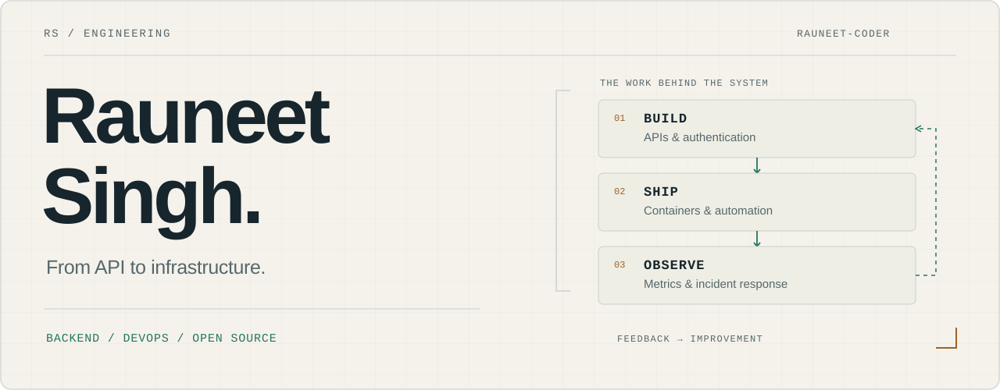

<picture>
  <source media="(prefers-color-scheme: dark) and (max-width: 600px)" srcset=".github/profile/hero-mobile-dark.svg">
  <source media="(max-width: 600px)" srcset=".github/profile/hero-mobile-light.svg">
  <source media="(prefers-color-scheme: dark)" srcset=".github/profile/hero-dark.svg">
  
</picture>

  <a href="#selected-work">Selected work</a> &nbsp; / &nbsp;
  <a href="https://github.com/jenkinsci/jenkins/pull/26966">Jenkins contribution</a> &nbsp; / &nbsp;
  <a href="https://www.linkedin.com/in/rauneet-singh-85369428b/">LinkedIn</a> &nbsp; / &nbsp;
  <a href="mailto:rauneetsingh1903@gmail.com">Get in touch</a>

## From API to infrastructure

I’m **Rauneet Singh**, a Computer Science undergraduate at **BCET** (AI & ML, 2024–2028). I build backend services and work on the infrastructure that runs them: authentication, containers, deployment automation, GPU workloads, and monitoring.

I’m interested in the whole lifecycle of a service—how it handles a request, how it gets deployed, and what happens when something fails.

### A contribution merged into Jenkins Core

**[PR #26966 · Fix missing event parameter in a keyboard handler](https://github.com/jenkinsci/jenkins/pull/26966)**

Replaced reliance on `window.event` with an explicit event argument in a dropdown keyboard handler. Worked through maintainer review; merged into Jenkins Core on **21 June 2026**.

## Selected work

### 01 &nbsp; MAIRS v2

**Infrastructure for a multi-agent incident-response prototype.**

My focus was GPU infrastructure and deployment: DigitalOcean GPU Droplets, containerized services, and monitoring with Prometheus and Grafana. I wrote lifecycle scripts to restore models and vector data from DigitalOcean Spaces, then back them up before tearing down compute between runs.

`Docker` · `DigitalOcean` · `Bash` · `Prometheus` · `Grafana`

**[Explore the project ↗](https://github.com/Rauneet-coder/mairs-v2)** &nbsp; · &nbsp; [Restore script](https://github.com/Rauneet-coder/mairs-v2/blob/main/setup.sh) &nbsp; · &nbsp; [Save & teardown script](https://github.com/Rauneet-coder/mairs-v2/blob/main/save_and_destroy.sh)

### 02 &nbsp; Encrypted document exchange

**A prototype for document confidentiality and verifiable provenance.**

SIH-237 explores encrypted document sharing, recipient key wrapping, and a signed provenance trail. It combines a Node.js API, a Next.js interface, and containerized services. The repository documents which capabilities are implemented and which still need infrastructure or further validation.

`Node.js` · `Express` · `MongoDB` · `Next.js` · `Docker`

**[Explore the project ↗](https://github.com/Rauneet-coder/SIH-237)** &nbsp; · &nbsp; [Implementation status](https://github.com/Rauneet-coder/SIH-237/blob/main/docs/engineering/PROJECT_STATE.md)

### 03 &nbsp; CourseHub

**A learning project connecting a course catalog to a backend API.**

Built with Node.js, Express, and MongoDB, with JWT authentication, bcrypt password hashing, Zod validation, and separate student and administrator routes. A practical place to work on API structure and the connection between frontend and backend.

`JavaScript` · `Express` · `MongoDB` · `JWT` · `Zod`

**[Explore the project ↗](https://github.com/Rauneet-coder/Backend-CourseSelling-App)**

## My working toolkit

| Layer | Tools I work with |
| :--- | :--- |
| **Backend** | JavaScript, Node.js, Express, REST APIs, JWT, bcrypt, Zod |
| **Data** | MongoDB / Mongoose, PostgreSQL / Prisma |
| **Delivery & infrastructure** | Docker, Kubernetes, Jenkins, GitHub Actions, Linux, Bash, DigitalOcean |
| **Observability** | Prometheus, Grafana |

## What I’m building toward

Deepening my understanding of system design, cloud infrastructure, and reliable delivery. I’m looking for **backend or DevOps internships** and opportunities to contribute to **open source**.

If your team works on APIs, developer tools, infrastructure, or AI systems, I’d like to hear what you’re building.

**[LinkedIn](https://www.linkedin.com/in/rauneet-singh-85369428b/)** &nbsp; · &nbsp; **[Email](mailto:rauneetsingh1903@gmail.com)** &nbsp; · &nbsp; **[More repositories](https://github.com/Rauneet-coder?tab=repositories)**
